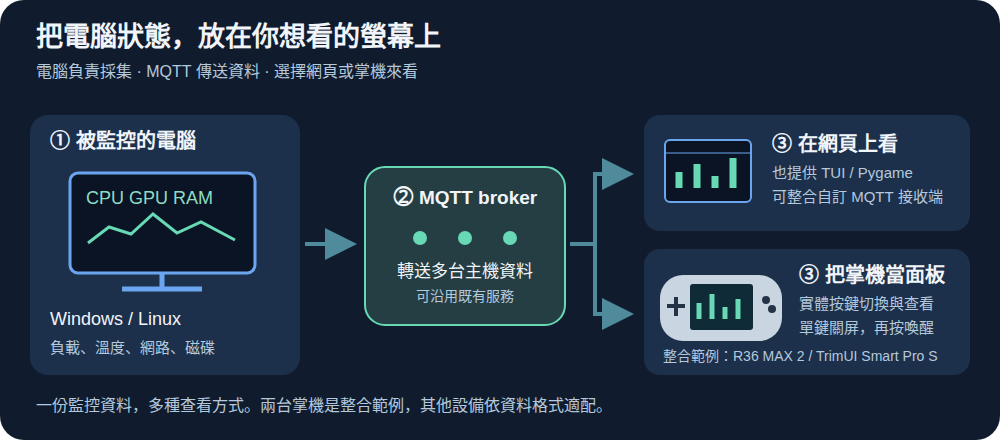

# MQTT Handheld Hardware Monitor

把 Linux 掌機變成桌上的電腦硬體監控螢幕，一台掌機查看多台電腦。



## 能做什麼

- 查看多台電腦的 CPU、GPU、RAM、網路、磁碟、溫度與趨勢。
- 從主機進入 PVE CT／VM 或 Docker 容器，查看狀態與資源使用量。
- 用掌機按鍵選取、翻頁及查看詳情，退出後回到原本選單。
- 單鍵關屏與喚醒，關屏時持續接收 MQTT 資料。

| 支援掌機 | 所需系統 | 狀態 |
| --- | --- | --- |
| R36 MAX 2 | dArkOS4Clone／Debian 13 ARM64 | 已實機驗證 |
| TrimUI Smart Pro S | 原廠 Buildroot ARM64 | 實驗支援，長時間穩定性待驗收 |

<details>
<summary>展開實機畫面與按鍵圖</summary>


</details>

## 自己安裝

準備支援的掌機、可用的 MQTT broker，以及已安裝 [hwmonitor-mqtt](https://github.com/KarlSideProjects/hwmonitor-mqtt) 的 Windows／Linux 電腦。資料流程是「電腦採集端 → MQTT broker → 掌機」。本專案提供掌機顯示端，不包含刷機映像。

1. 讓掌機連上網路、啟用 SSH，並退出遊戲或監控，回到原本選單。
2. 在有 Git、Bash、SSH 的電腦終端下載本專案：

   ```bash
   git clone https://github.com/KarlSideProjects/mqtt-handheld-hardware-monitor.git
   cd mqtt-handheld-hardware-monitor
   ```

3. 執行對應型號的安裝命令，將 `<掌機IP>` 換成自己的位址，兩條擇一：

   ```bash
   # R36 MAX 2
   bash browser/install.sh --ssh <掌機IP>
   # TrimUI Smart Pro S
   bash browser/install-trimui.sh --ssh <掌機IP>
   ```

4. 依終端提示完成 SSH 登入及 MQTT 設定。腳本會安裝相依套件、備份既有檔案並保留既有 MQTT 設定；保存輸出的備份路徑，帳密與備份保持私有。
5. 從 R36 的 **Ports → Hardware Monitor**，或 TrimUI 的 **應用 Apps → Hardware Monitor** 開啟，確認電腦資料持續更新。**A** 進入、**B** 返回；R36 用 **FN** 關屏、**Select + B** 退出，TrimUI 用 **X** 關屏、**Select + Start** 退出。

帳密、空間需求及安裝檢查見 [完整安裝說明](docs/installation.md)；還原與疑難排解見 [維護細節](docs/user-guide.md#安裝到掌機)。全新系統安裝及還原的實機驗證範圍，請先閱讀該文件。

## 給 AI 的安裝 prompt

把下面貼給能讀取 GitHub、執行終端與 SSH 的 AI 助理，填入型號與 IP。密碼請在本機終端輸入。

```text
請幫我安裝 https://github.com/KarlSideProjects/mqtt-handheld-hardware-monitor。
我的掌機型號是［填入型號］，IP 是［填入 IP］。
先讀 README、docs/installation.md 與 docs/device-controls.md，確認設備
和作業系統符合支援清單，再檢查現有安裝並保留設定與備份。
R36 MAX 2 使用 browser/install.sh；TrimUI Smart Pro S 使用
browser/install-trimui.sh。依文件使用 --ssh 連線安裝，讓對應腳本安裝相依套件。
SSH 先嘗試文件列出的預設登入方式，失敗時讓我在本機終端輸入帳密；
MQTT 優先沿用私有設定，缺少 broker 資訊或驗證失敗時提示我補充並重試。
不要把帳密寫進 Git 或公開輸出。若 AI 終端無法互動，提供需要我執行的命令。
若電腦採集端尚未準備，先依 KarlSideProjects/hwmonitor-mqtt 的文件協助安裝。
完成後確認 MQTT 連線及主機資料持續更新，告訴我如何從掌機選單開啟。
請引導我實際確認畫面、方向鍵、A/B、關屏與喚醒以及退出回選單，
分開回報自動檢查通過與尚需人工確認的項目。不要自行刷機。
```

詳細操作與限制見 [使用指南](docs/user-guide.md)，按鍵位置見 [圖解](docs/device-controls.md)，開發驗證見 [CI 手冊](docs/ci-validation.md)。程式碼採 [GPL v3](LICENSE)。
