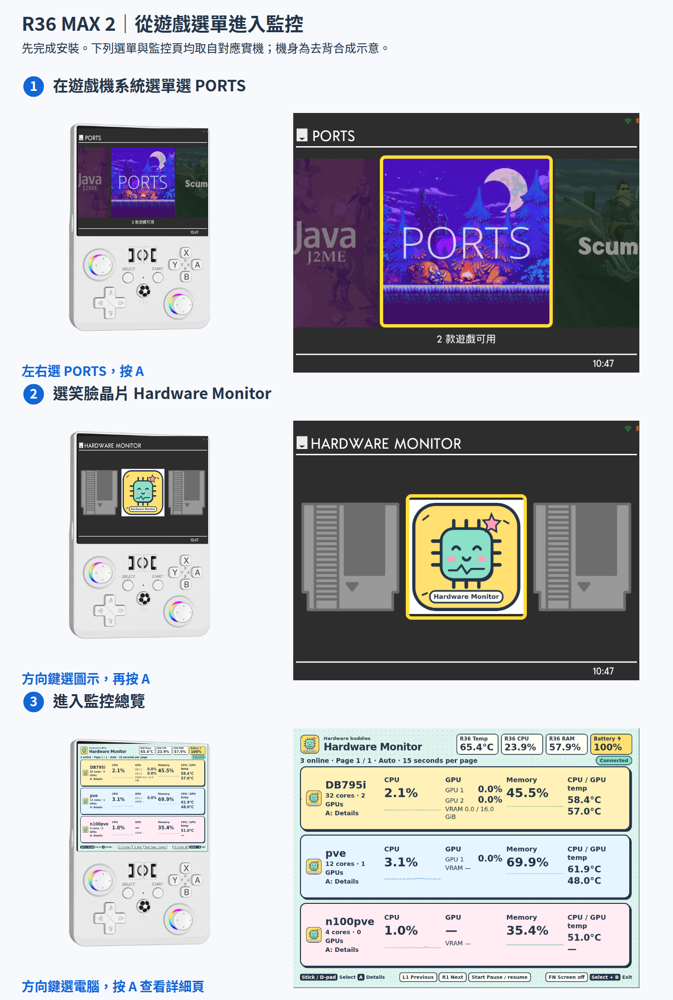
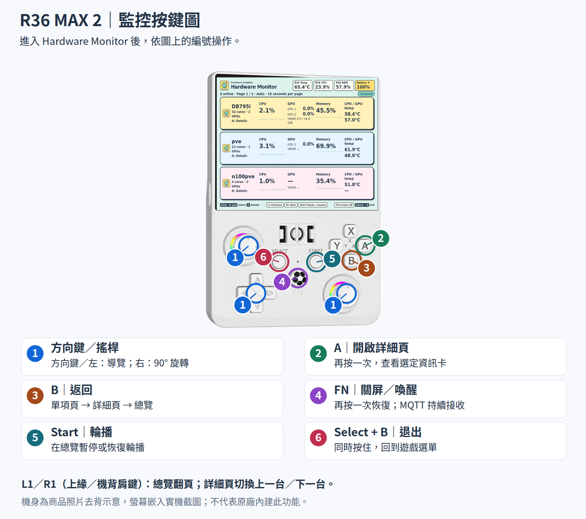
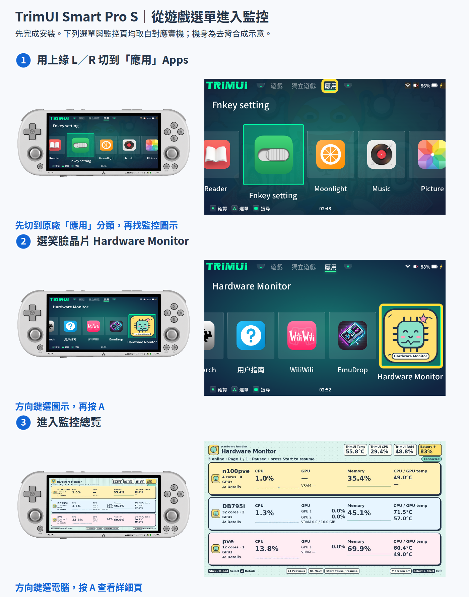
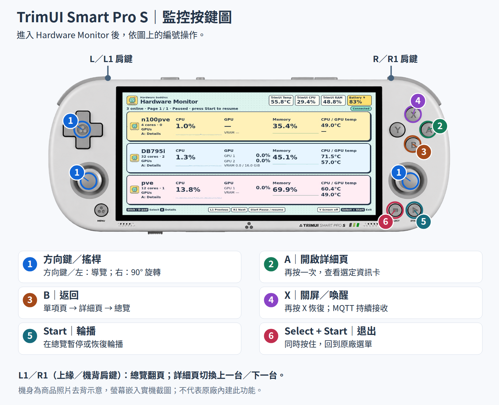

# 從遊戲機選單開啟與操作監控面板

先依 [安裝說明](installation.md) 安裝 Hardware Monitor。下圖用遊戲機的實際選單截圖標示入口，再用去背機身圖標出監控按鍵；點圖可放大。

## R36 MAX 2：進入監控

在 dArkOS4Clone 的系統選單左右選 **PORTS → 按 A → 選 Hardware Monitor 笑臉晶片圖示 → 再按 A**。



## R36 MAX 2：按鍵功能



## TrimUI Smart Pro S：進入監控

在原廠選單用上緣 **L／R 切到「應用」Apps**，再用方向鍵選 **Hardware Monitor 笑臉晶片圖示 → 按 A**。新安裝的圖示可能在應用清單後面，往右繼續找。



## TrimUI Smart Pro S：按鍵功能

關屏／喚醒請按機身 **X**。監控頁若顯示 Y 提示，實際操作以圖上標示的 X 為準，按鍵設定未變。



## 共用功能速查

| 操作 | 功能 |
| --- | --- |
| 方向鍵／兩支搖桿 | 總覽選電腦與翻頁；詳細頁選資訊卡；單項頁切換類別或項目頁 |
| A | 總覽進入電腦詳細頁；再按一次開啟選定資訊卡 |
| B | 單項頁返回詳細頁，再返回總覽 |
| L1／R1（TrimUI 上緣 L／R） | 總覽翻頁；詳細頁切換上一台／下一台電腦 |
| Start | 在總覽暫停或恢復自動輪播 |
| R36 FN／TrimUI X | 關閉顯示與背光；再按同一鍵喚醒，MQTT 持續接收 |
| R36 Select + B／TrimUI Select + Start | 同時按住，退出監控並回到遊戲機選單 |

監控頁可查看 CPU、GPU、顯示記憶體、記憶體、網路、磁碟、溫度與趨勢；顯示內容取決於電腦採集端回報。完整導覽規則見 [使用指南按鍵說明](user-guide.md#r36-max-2-按鍵操作)。

## 圖片來源與維護

機身素材來自 [R36 MAX 2 販售頁](https://r36max.net/products/r36max-2) 的 [白色機身照片](https://r36max.net/cdn/shop/files/1000014442.jpg?v=1775387115)，以及 [TrimUI 官方 Smart Pro S 頁面](https://trimui.com/pages/trimui-smart-pro-s)的 [白色機身照片](https://trimui.com/cdn/shop/files/SMART_PROS_EN_10.jpg?v=1766559228)。商品照片經 AI 去背，只保留單台遊戲機。原照片權利屬原作者，未標示自由圖片授權；本專案的 GPL 授權不包含這些第三方素材的原始權利。

選單與監控頁由本專案在對應設備讀回實際 framebuffer 擷取。機身內的螢幕為教學合成，右側放大圖是相同的實機截圖，黃色框是教學標示。R36 的 EmulationStation 介面使用 [es-theme-switch](https://github.com/Jetup13/es-theme-switch)。選單外觀與圖示順序可能隨主題、語言及已安裝 Apps 改變。

可編輯來源為 [render-device-guides.py](render-device-guides.py) 與 `images/*.svg`。更新圖片或按鍵後，先產生 SVG，再用已備妥 Playwright Chromium 的環境產生 PNG：

```bash
python3 docs/render-device-guides.py
node docs/render-device-guides.cjs
```

重新輸出後需目視確認標記對準實體按鍵、入口框選正確，並確認兩台設備退出後可重新進入監控。
